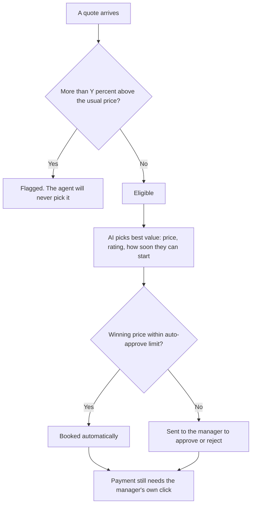
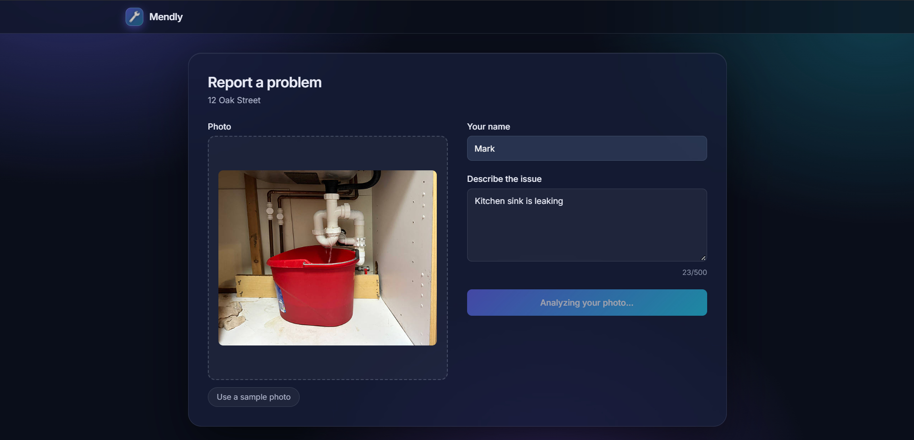
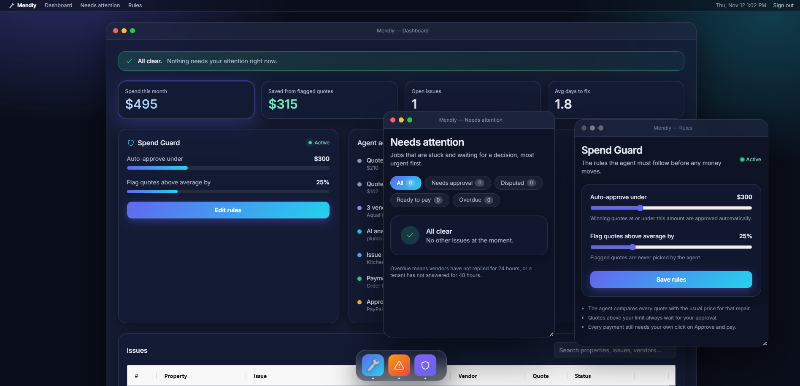
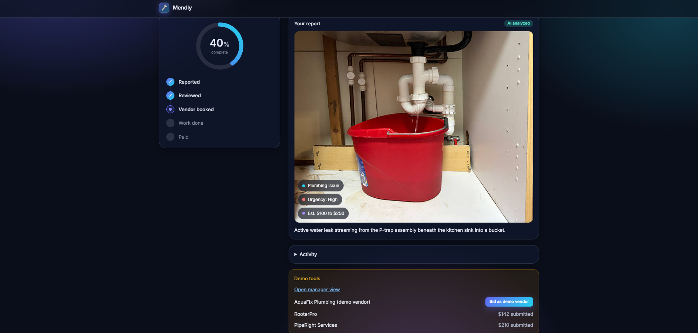
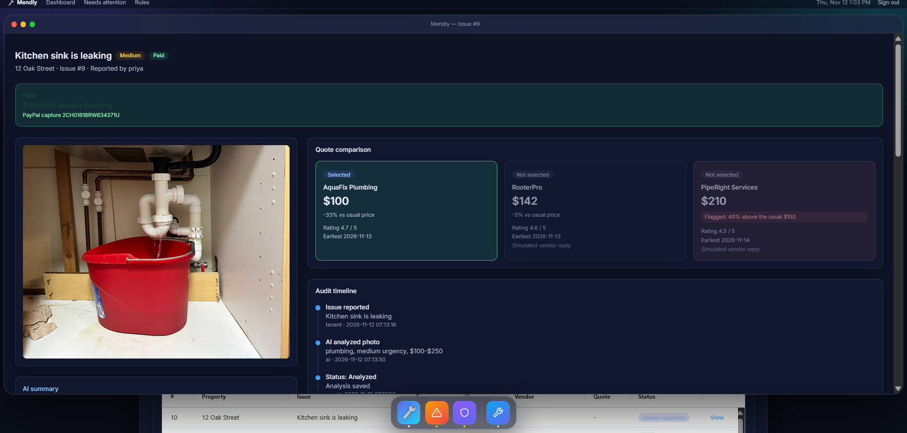
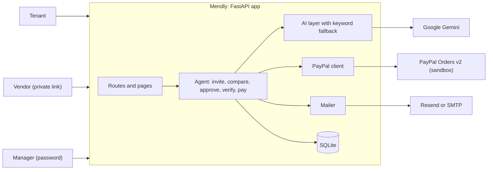

<div align="center">


# Mendly

### Maintenance that runs itself. You keep the ownership.

An AI agent that takes a repair from one tenant photo to a verified, **PayPal-paid** job, and never spends a dollar the manager hasn't allowed.

[**Live demo**](https://mendly-r0u3.onrender.com) &nbsp;·&nbsp; [**Demo video**](YOUR_YOUTUBE_URL) &nbsp;·&nbsp; Built for the PayPal AI Hackathon

-0070BA?style=flat-square)


</div>

---

## The problem

A tap leaks. The tenant sends a blurry photo in a group chat. The manager phones three plumbers, waits for replies, compares prices by memory, books one, and later asks the tenant if it's really fixed. Then someone has to pay.

None of that is skilled work. It's **chasing**, and for a property manager with a few dozen units it eats the week.

## Who it's for

Small landlords and property managers with roughly **10 to 50 units**: too many repairs to handle by hand, too small for an enterprise maintenance platform.

## What Mendly does

You get a maintenance coordinator that works around the clock, with one rule it can't break:

> **The agent proposes. The manager decides. PayPal moves the money.**

Tenants report a problem with a photo. The agent diagnoses it, collects and checks quotes, books the best vendor, verifies the finished work, and prepares the payment. It handles the chasing, and you keep the ownership of every dollar.

---

## How it works

```mermaid
flowchart LR
    A["Tenant sends a photo and a line of text"] --> B["Gemini diagnoses: trade, urgency, cost range"]
    B --> C["Agent invites up to 3 vendors by private link"]
    C --> D["Quotes come in and are checked against typical prices"]
    D --> E{"Spend Guard"}
    E -->|"Within your limit"| F["Best-value vendor booked automatically"]
    E -->|"Above your limit"| G["Manager reviews and approves"]
    G --> F
    F --> H["Vendor does the work and uploads an after photo"]
    H --> I["Tenant confirms. Gemini compares before and after"]
    I --> J["Manager approves the payment"]
    J --> K["PayPal captures the payment. Job closed as Paid"]
```



### Spend Guard: the part that keeps you in control

The manager sets two rules. The agent follows them and cannot change them.



Even when a job is booked automatically, **no payment leaves without the manager's click on "Approve and pay".**

### The life of one job

```mermaid
stateDiagram-v2
    direction LR
    state "Quotes requested" as QR
    state "Quotes received" as QRC
    state "Needs manager" as NM
    state "Work submitted" as WS
    state "Ready to pay" as RTP

    [*] --> New
    New --> Analyzed: Gemini reads the photo
    Analyzed --> QR: vendors invited
    QR --> QRC: all quotes in
    QRC --> Scheduled: within limit
    QRC --> NM: above limit
    NM --> Scheduled: manager approves
    NM --> Rejected: manager rejects
    Scheduled --> WS: after photo uploaded
    WS --> Verified: fixed and photo check passes
    WS --> Disputed: tenant says not fixed, or low confidence
    Disputed --> Verified: manager overrides
    Disputed --> Scheduled: sent back to the vendor
    Verified --> RTP
    RTP --> Paid: manager pays through PayPal
    Paid --> [*]
```



Every change is written to an **audit trail** with who did it and why, so nothing the agent does is a black box.

---

## Where PayPal and AI fit

| | What it does in Mendly |
|---|---|
| **Gemini: reads the problem** | Looks at the tenant's photo and returns the trade, urgency, a fair cost range and a one-line summary. |
| **Gemini: judges the quotes** | Recommends the best value among quotes that passed the price rules. |
| **Gemini: verifies the fix** | Compares the before and after photos and returns a confidence score. At 70% or higher the job is verified. Below that, the manager decides. |
| **PayPal: moves the money** | "Approve and pay" creates a PayPal order for the exact quoted amount. The manager approves it on PayPal's own page, and Mendly captures the payment. |
| **PayPal: safe by design** | Each payment attempt has its own request ID, so a double click can't pay twice. Order and capture IDs are stored on the job. |

If Gemini is unavailable, the app doesn't break. It falls back to keyword matching and the lowest fair quote, sends photo checks to the manager, and says so in the activity log.

---

## Three people, three screens

| Who | What they get |
|---|---|
| **Tenant** | A property link such as `/report/OAK12`, then a live status page with a progress tracker, the AI scan and a before and after slider. |
| **Vendor** | A private link per job. Send a quote, later upload a completion photo. No account, no password. |
| **Manager** | A password-protected dashboard: a "needs attention" list, the full audit trail, and the Spend Guard rules. |

### See it in action

<table>
<tr>
<td width="50%"><br><sub><b>1. Report.</b> One photo and one line from the tenant.</sub></td>
<td width="50%"><br><sub><b>2. Quotes.</b> Gemini reads the photo, and vendors reply with quotes.</sub></td>
</tr>
<tr>
<td width="50%"><br><sub><b>3. Control.</b> The manager sets the Spend Guard rules.</sub></td>
<td width="50%"><br><sub><b>4. Paid.</b> The overpriced quote is flagged, the fair one wins, PayPal captures the payment.</sub></td>
</tr>
</table>

---

## Try it in two minutes

Open the **[live demo](https://mendly-r0u3.onrender.com)**. It runs in demo mode with PayPal sandbox money, so no real money moves. The first load can take about a minute while the free server wakes up.

1. Click **Report a problem**, tap **Use a sample photo**, and submit.
2. Watch the AI scan. Two simulated vendors reply on their own.
3. In **Demo tools**, click **Bid as demo vendor** and send a quote. Try an overpriced one and watch the agent refuse it.
4. If the winning quote is above the limit, click **Open dashboard** and approve it.
5. Click **Selected vendor link** and upload the sample after photo.
6. Back on the status page, drag the slider and click **Yes, fixed**.
7. As the manager, click **Approve and pay**, then sign in with the PayPal sandbox login shown on the page.
8. The job closes as **Paid**.

---

## Run it yourself

You need Python 3.12 or newer.

```bash
git clone https://github.com/Anushree876/mendly-maintenance-agent.git
cd mendly-maintenance-agent

python -m venv venv
source venv/Scripts/activate        # Windows (Git Bash)
# source venv/bin/activate          # Mac / Linux

pip install -r requirements.txt
```

Create a `.env` file in the project folder:

```env
GEMINI_API_KEY=your_gemini_key
GEMINI_MODELS=gemini-3.1-flash-lite,gemini-3.5-flash

PAYPAL_CLIENT_ID=your_sandbox_client_id
PAYPAL_SECRET=your_sandbox_secret
PAYPAL_BASE=https://api-m.sandbox.paypal.com
CURRENCY=USD

MANAGER_PASSWORD=choose_a_password
BASE_URL=http://127.0.0.1:8000
DEMO_MODE=true

# Optional: shows a PayPal sandbox login in demo mode
DEMO_PAYPAL_EMAIL=
DEMO_PAYPAL_PASSWORD=

# Optional: real emails to vendors and the manager
SMTP_HOST=smtp.gmail.com
SMTP_PORT=587
SMTP_USER=
SMTP_PASS=
REAL_VENDOR_EMAIL=
MANAGER_EMAIL=
RESEND_API_KEY=
```

Load the starting data once, then start the app:

```bash
python -m app.seed
uvicorn app.main:app --reload
```

Open http://127.0.0.1:8000

Keys: Gemini at https://aistudio.google.com/apikey, and PayPal sandbox keys plus a test buyer account at https://developer.paypal.com.

**Demo mode vs real mode.** With `DEMO_MODE=true`, the shortcuts appear: sample photos, one-click manager access and a reset button. With `DEMO_MODE=false`, they all disappear. The manager signs in with a password and vendors receive their links by email.

---

## Architecture



```
app/
  main.py        routes, login, demo helpers
  agent.py       the workflow: invite, compare, approve, verify, pay
  ai.py          Gemini calls, with keyword fallback
  paypal.py      create and capture PayPal orders
  mailer.py      email through Resend or SMTP
  db.py          database and job statuses
  seed.py        demo data
  templates/     all pages
  static/        styles, logo, sample photos
```

---

## What is real, and what is simulated

I'd rather be upfront about the stage this is at.

- **Real:** the Gemini photo analysis, the price checks, the Spend Guard rules, the vendor page, the audit trail and the PayPal payment flow (in PayPal's sandbox).
- **Simulated:** most vendors in the demo reply automatically. One vendor can be played by you through a real private link.
- **Not yet:** real money, real vendor accounts and multi-manager support. It uses one SQLite file, which is fine for a prototype.

## What comes next

1. Pay each vendor **directly to their own PayPal account**.
2. WhatsApp and SMS instead of email, since that's where tenants and vendors already are.
3. Repeat-issue detection: a tap that keeps leaking raises a flag before it becomes a flood.
4. Vendor sign-up with trade and rating verification.
5. Many properties and many managers.

---

## Built with

Python and FastAPI · Jinja2 · SQLite · Google Gemini (vision and text) · PayPal Orders v2 (sandbox) · Pillow · httpx · Resend or SMTP

I used AI coding assistance to build this, and I'm disclosing it in line with the hackathon rules.

## License

MIT. See [LICENSE](LICENSE).

<div align="center">

Built by **Anushree Gupta** · [@Anushree876](https://github.com/Anushree876)

</div>
